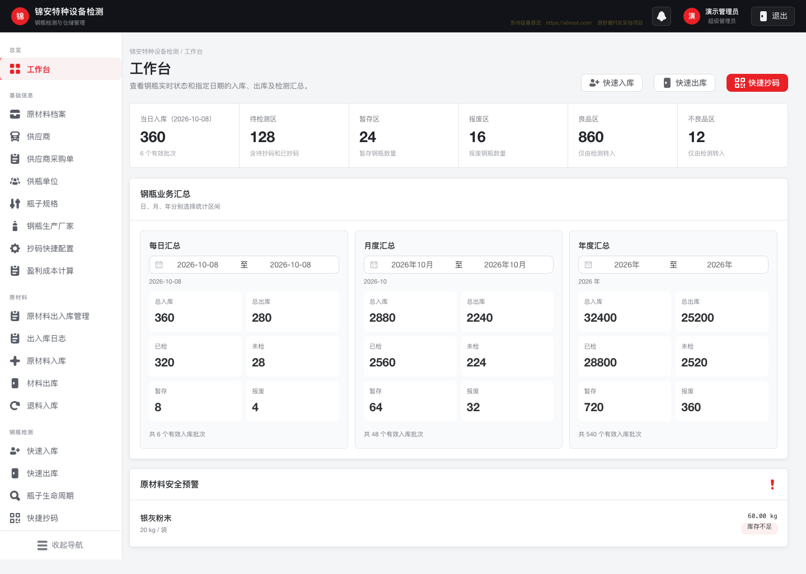
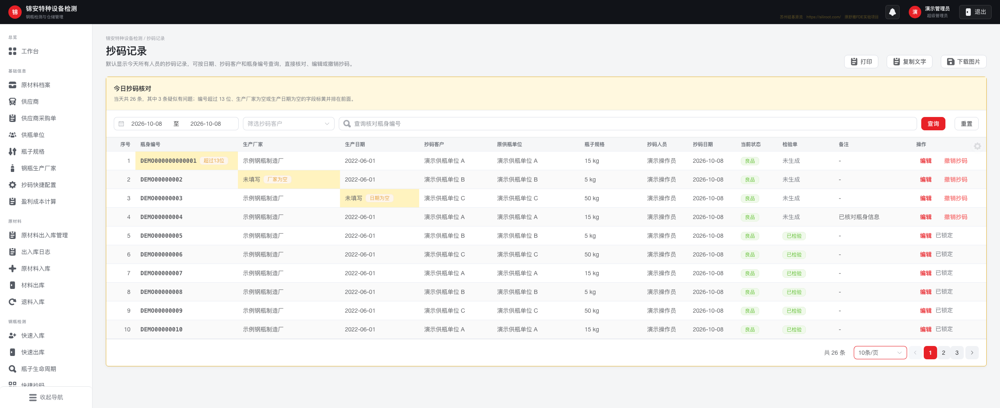
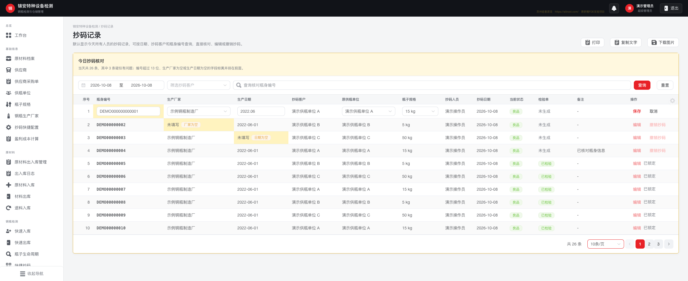
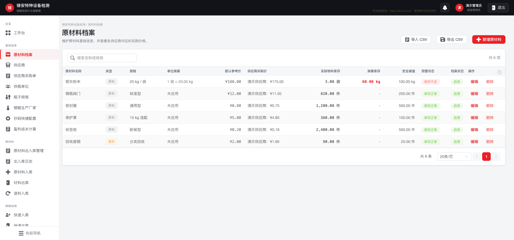
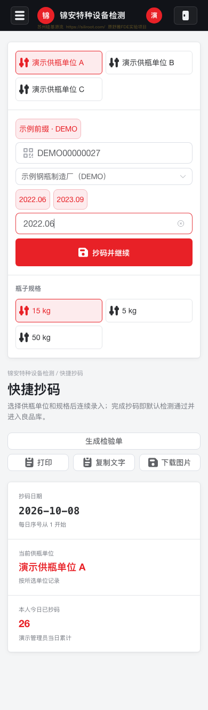

# JA LiteMOM · 锦安钢瓶检测与仓储管理

面向钢瓶检测业务的轻量管理系统，覆盖钢瓶入库、扫码抄码、质量分类、检验单、出库与盘点，同时管理原材料、采购、库存预警和人员权限。

项目基于 **Vue 3 + TypeScript + FastAPI + PostgreSQL**，支持桌面端业务管理和移动端连续录入。仓库名为 `JA_LiteMOM`，源码和部署配置沿用 `AILiteWMS` / `ailitewms` 标识。

[功能概览](#功能概览) · [界面预览](#界面预览) · [快速启动](#快速启动) · [本地开发](#本地开发) · [开发协作](AGENTS.md)

## 功能概览

| 模块 | 主要能力 |
| --- | --- |
| 工作台 | 实时钢瓶分区库存，日／月／年业务汇总，原材料安全库存预警 |
| 钢瓶出入库 | 按客户、规格和批次入库，快速出库，历史单据及收发记录导出 |
| 快捷抄码 | 扫码或输入编号，厂家前缀匹配，生产年月快捷录入，移动端连续操作 |
| 抄码核对 | 单表查询、直接编辑和撤销；日期区间、客户、编号筛选；异常全局优先后分页 |
| 质量与追溯 | 良品／不良品分类、退还客户标记、钢瓶生命周期记录 |
| 检验单 | 多日期按客户合并、连续序号拆单、跨客户调整、拆单历史、驳回和重检 |
| 库存盘点 | 日度与月度盘点、手工调整、修改日志、库存摘要 |
| 原材料 | 档案、单位换算、采购价格、入库／出库／退料、按日出入库及预警 |
| 人员与界面 | 页面与操作权限、菜单分组和排序、表格列偏好 |
| 报表输出 | 打印、复制摘要、图片、CSV、Excel 和 Word，按具体业务页面提供 |

钢瓶业务主线：**入库 → 待抄码 → 抄码核对 → 检验单／质量分类 → 出库 → 盘点与追溯**。快捷抄码按当前业务规则默认检测通过并进入良品库。

## 界面预览

以下均为当前应用的真实页面截图，使用脚本提供的**虚构演示数据**，不含生产客户、员工或库存记录。截图日期与数据用于展示界面，不代表线上业务状态。

### 工作台：库存与业务汇总

集中查看待检测、暂存、报废、良品和不良品库存；日、月、年可分别选择统计区间，低库存原材料单独提示。



### 抄码记录：一个表格完成核对与处理

日期、客户和瓶身编号统一筛选，编号超过 13 位、厂家为空或生产日期为空的记录优先显示并标黄。分页前完成整体异常排序，同时展示客户、供瓶单位、规格、状态和备注。



### 表内编辑：在记录上直接修正

编号、厂家、生产日期、供瓶单位和规格可直接进入编辑。操作列同时提供撤销抄码；已检验记录保留撤销锁定，供瓶单位及规格也受既有编辑限制。



### 原材料档案：单位换算与供应商价格

维护材料规格、参考价格和供应商采购价，查看实际物料库存、换算库存及安全阈值，支持 CSV 导入导出。



### 移动端快捷抄码

选择供瓶单位和规格后连续录入瓶身编号，生产年月支持快捷选择，厂家可按编号前缀匹配。适合现场用手机浏览器配合扫码设备录入。



截图可重新生成，见[截图说明](docs/screenshots/README.md)。

## 技术栈与目录

| 层 | 技术 |
| --- | --- |
| 前端 | Vue 3、TypeScript、Vite、Element Plus、Vue Router、Axios |
| 后端 | FastAPI、SQLAlchemy 2、Pydantic、JWT |
| 数据库 | PostgreSQL 16；本地开发也可使用 SQLite |
| 文档 | python-docx、openpyxl、xlrd／xlwt、前端 docx |
| 部署与测试 | Docker Compose、Nginx、pytest、Puppeteer |

```text
JA_LiteMOM/
├── backend/
│   ├── app/                 # API、模型、权限、库存与报告逻辑
│   │   └── templates/       # 私有报告模板的放置位置
│   ├── scripts/             # 模板维护脚本
│   └── tests/               # 后端业务回归
├── frontend/
│   ├── src/views/           # 业务页面
│   ├── src/components/      # 共享表格、权限外壳与报表组件
│   ├── scripts/             # 演示截图生成
│   └── tests/               # 浏览器交互回归
├── docs/                    # 需求、部署说明与截图
├── docker-compose.yml       # 开发／首次构建
├── docker-compose.deploy.yml # 使用预构建镜像发布
└── AGENTS.md                # 项目协作约定
```

## 快速启动

需要 Docker Engine / Docker Desktop 和 Docker Compose v2。

```bash
git clone https://github.com/auenger/JA_LiteMOM.git
cd JA_LiteMOM
cp .env.example .env
```

编辑 `.env`，设置数据库密码、JWT 密钥以及两名初始管理员的密码，然后启动：

```bash
docker compose -p ailitewms up --build -d
```

- 应用：<http://localhost:8080>
- 健康检查：<http://localhost:8080/api/health>
- 本地后端开发时的 API 文档：<http://127.0.0.1:8000/docs>（当前 Nginx 未代理此路径）。

`APP_PORT` 控制前端端口。PostgreSQL 数据保存在 Compose 数据卷中；已有部署请沿用原 Compose 项目名，以复用相同数据卷。

```bash
# 停止容器并保留数据卷
docker compose -p ailitewms down
```

请勿在需要保留数据的环境使用 `down -v`。

### 报告模板与仓库边界

本公开仓库包含应用源码、测试、依赖锁文件和演示截图。数据库、生产配置、部署备份、原始客户文档及带有签名图片的 Word 模板不提交。

**基础页面和业务接口可以启动；部分 Word 导出及相关完整测试需要另外补齐报告模板。** 文件名与说明见 [backend/app/templates/README.md](backend/app/templates/README.md)。请使用获授权的模板，并在构建后端镜像前放入指定目录。

### 初始账号

新数据库启动时按 `.env` 中的 `INITIAL_ADMIN_*` 和 `SECOND_ADMIN_*` 创建两个管理员。默认用户名分别为 `admin` 和 `admin_backup`，密码应由部署者设置。已有账号密码不会随环境变量更改，可在应用内修改。

## 本地开发

建议使用 Python 3.12（与后端镜像一致）和 Node.js 22。以下命令从仓库根目录执行：

```bash
python3 -m venv .venv
.venv/bin/pip install -r backend/requirements.txt
cp .env.example .env
# 编辑 .env，设置本地 JWT 密钥、管理员密码。
```

终端一启动后端；未设置 `DATABASE_URL` 时使用根目录的 SQLite 数据库：

```bash
CORS_ORIGINS=http://localhost:5173,http://127.0.0.1:5173 \
  .venv/bin/uvicorn app.main:app --app-dir backend --reload
```

终端二启动前端：

```bash
cd frontend
npm ci
npm run dev
```

访问 <http://localhost:5173>。Vite 将 `/api` 代理到本地 `8000` 端口。若使用本地 PostgreSQL，可通过 `DATABASE_URL` 指定 SQLAlchemy 连接地址。

## 验证与测试

```bash
# 前端类型检查和生产构建
cd frontend
npm run build
```

```bash
# 在根目录执行；完整回归需已补齐私有模板
.venv/bin/python -m pytest backend/tests -q
```

浏览器测试需要本机 Chrome，可通过 `CHROME_PATH` 指定路径。以单表抄码回归为例，先启动前端开发服务，再执行：

```bash
cd frontend
npm run test:coding-filters
```

该测试拦截 API 并使用模拟数据，覆盖编辑、筛选、分页、撤销确认、已检验锁定和末页回退。其他脚本中部分需要后端及测试账号，执行前请阅读脚本；不要把有写操作的业务测试指向生产环境。

## 部署与协作

- [通用部署指南](docs/deployment.md)：配置、预构建镜像、备份与回滚。
- [AGENTS.md](AGENTS.md)：目录入口、业务约束、验证和提交约定。
- [一期功能范围](docs/第一期功能范围确认与需求分析-v0.3.md)、[原材料模型](docs/原材料模型与可配置业务规则-v0.2.md)：业务背景。
- [检验单模板说明](docs/inspection-word-templates.md)：报告分组和模板行为。

请让 API 权限、前端菜单权限、数据统计口径和测试同步更新。库存、拆单、撤销及报告编号变更尤其需要业务回归。

## 资源与许可

界面图标使用 Nieobie Game Icon Pack，许可为 [CC0 1.0](frontend/public/icons/game-icon-pack/LICENSE)。项目代码尚未单独指定开源许可证；第三方资源遵循各自许可，业务报告模板及签名不随公开仓库分发。
